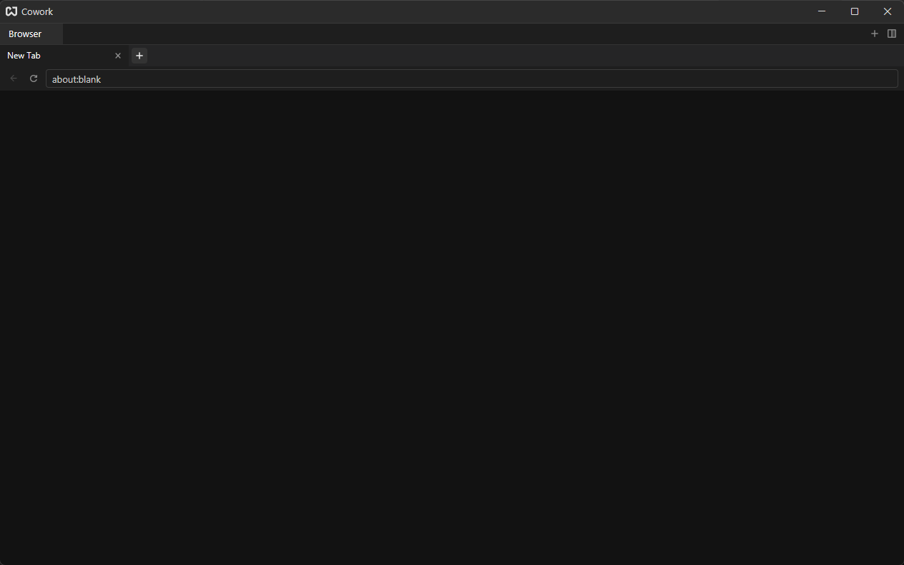
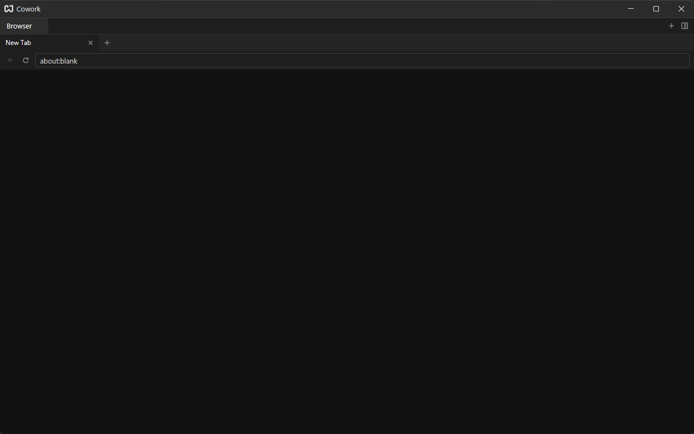

# Browser

Choose **Browser** on the [launcher](./getting-started.md#launcher) for a web page that lives in a Cowork tab. Pages are rendered by Chromium (through CEF), so sites behave as they do in any Chromium browser.

A new browser tab starts on a blank page:

## The Toolbar {#toolbar}

Across the top of the browser tab:

- a strip of page tabs, with a button to add one. These are tabs **inside** the browser tab, so one Cowork tab can hold several pages;
- **back** and **reload** buttons;
- the address bar.

Type an address in the bar and press `Enter` to load it. What you type is turned into a URL like this:

| You type                     | Cowork loads          |
| ---------------------------- | --------------------- |
| `example.com`                | `https://example.com` |
| `https://example.com/page`   | the same URL          |
| `http://localhost:3000`      | the same URL          |
| `file:///C:/notes/page.html` | the same file         |
| `about:blank`                | a blank page          |
| nothing                      | a blank page          |

`http://`, `https://`, `file://`, `about:` and `data:` addresses are kept as typed; anything else gets `https://` in front. The bar does not search the web: a plain word becomes `https://word`.

## Page Tabs {#page-tabs}

Add a page tab with the `+` in the browser's own strip (it opens your home page, `about:blank` unless you changed it on the Browser page of [Settings](./settings.md#browser)), switch by clicking, and close a page tab with its close button. Closing the last one leaves a blank page. The Cowork tab's title follows the page you are on.

## Splitting {#splitting}

Splitting a browser tab opens a new browser with one blank page. Open pages are not duplicated.

## Sessions {#sessions}

Your open pages are remembered (unless **Restore Pages** is turned off in [Settings](./settings.md#browser)): after a restart the browser tab comes back with every page tab and its address, and which one was active. The pages are loaded again; form input and scroll position are not kept.

## Requirements {#requirements}

The browser needs the CEF runtime next to the executable; see [Installation](./installation.md#shipping). If it is missing the tab shows "CEF is not running". The page cache and a log (`cef.log`) are kept in `%LOCALAPPDATA%\cowork\`.
