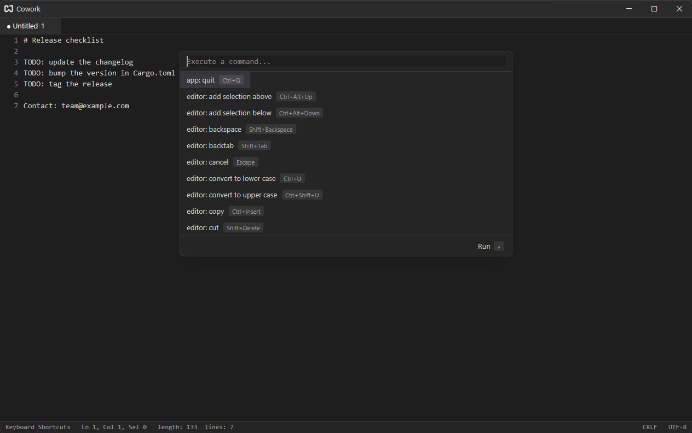
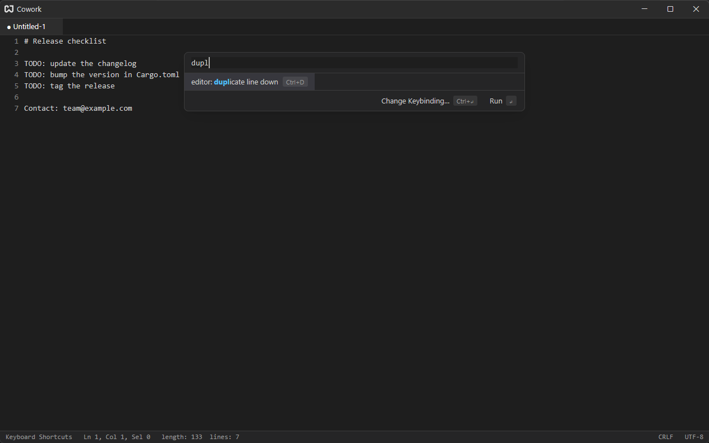

# Command Palette

The command palette is the main way to find actions. Its shortcut is the first one to learn: {#kb command_palette::Toggle}.

To try it, open the palette and type `new file`. The list narrows to {#action workspace::NewFile}; press `Enter` to create a note.

Anywhere these docs say `editor: ...` or `workspace: ...`, run that command in the palette.

## What the Palette Lists {#what-it-lists}

The palette lists the actions that the thing you were focused on can handle. Open it from an editor and you see the editor's commands (`editor: duplicate line down`, `editor: go to line`, ...) as well as the window-level ones (`workspace: open file`, `pane: split right`). Open it from a terminal and you see the terminal's commands instead. If a command you expect is missing, close the palette, click where you want it to apply, and open it again.

Command names are the action names made readable: `editor::DuplicateLineDown` is `editor: duplicate line down`. You can search with either spelling: `editor::DuplicateLineDown` and `editor: duplicate line down` find the same command.

## Searching {#searching}

Search is fuzzy: `dupl` matches `editor: duplicate line down`, and the letters that matched are highlighted. Extra spaces and doubled colons are ignored.

Each row shows the command's key binding, if it has one, so the palette doubles as a shortcut finder.

## Keyboard {#keyboard}

| Action                            | Key                                     |
| --------------------------------- | --------------------------------------- |
| Run the selected command          | `Enter`                                 |
| Move the selection                | `Down` / `Up` or `Ctrl+N` / `Ctrl+P`    |
| Close the palette                 | {#kb editor::Cancel}                    |
| Change the selected command's key | {#kb command_palette::SecondaryConfirm} |

You can also click a command to run it.

## Recent Commands {#recent}

Commands you have run from the palette rise to the top, most recent first, whenever the search box is empty or matches several commands. Each of them has a `✕` that forgets it, so it drops back to its normal place.

The palette also remembers what you typed. With the cursor on the first row, `Up` walks back through earlier queries; if you had typed a few letters first, only queries starting with them are offered. `Down` walks forward and finally returns to what you were typing.

Commands you run with a key binding do not count: if you already know the shortcut you are unlikely to look the command up here.

## Changing a Key Binding {#change-keybinding}

When the selected command is an editor command, the palette footer shows **Change Keybinding…** (or **Add Keybinding…** when it has none). Choosing it closes the palette, opens the [shortcuts drawer](./key-bindings.md#shortcuts-drawer) on that command, and waits for the new keys.

Commands that are not in the drawer (for example `pane: split right`) show only **Run**.

## For Developers {#for-developers}

The `command_palette` crate lets other code shape the results:

- `register_alias(cx, "w", "editor: save")` makes typing exactly `w` search for `editor: save`.
- `register_interceptor(cx, |query, cx| ...)` can return extra entries for a query, with the action each one runs, and can make them exclusive (hiding the fuzzy matches). Entries added this way are not counted as recent commands.

Usage and query history are stored in `command-palette.txt` in the [config folder](./configuration-files.md).
