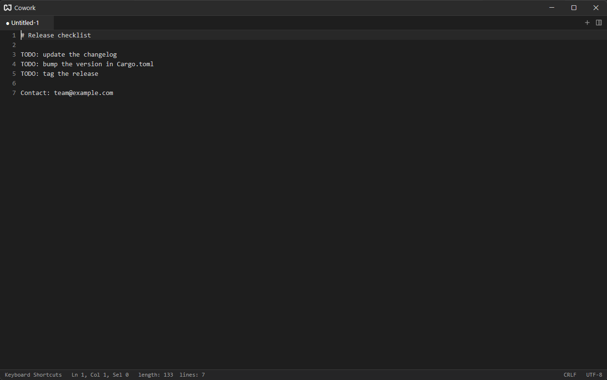
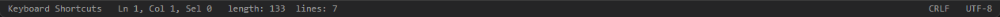

# Editor

The editor is for text: scratch notes, config files, logs. Choose **Text** on the [launcher](./getting-started.md#launcher), press {#kb workspace::NewFile} for an empty note, or press {#kb workspace::OpenFile} to open files.

The text size and the width of a tab stop are on the Editor page of [Settings](./settings.md#editor).

## Notes and Files {#notes-and-files}

An empty note is called `Untitled-1`, `Untitled-2`, and so on. You do not have to save it: notes and unsaved edits are kept between runs ([Sessions & Quick Notes](./sessions.md)).

| Action                 | Shortcut                  |
| ---------------------- | ------------------------- |
| Open one or more files | {#kb workspace::OpenFile} |
| Save                   | {#kb editor::Save}        |
| Save as                | {#kb editor::SaveAs}      |

Saving a note with no file asks where to put it. Opening a file that is already open in the pane jumps to its tab instead of opening a second copy.

## Selecting and Moving {#selecting}

The usual keys work: arrows, `Home`/`End`, `PageUp`/`PageDown`, and `Shift` to extend the selection.

| Action                      | Shortcut                                                                    |
| --------------------------- | --------------------------------------------------------------------------- |
| Previous / next word        | {#kb editor::MoveToPreviousWordStart} / {#kb editor::MoveToNextWordEnd}     |
| Select previous / next word | {#kb editor::SelectToPreviousWordStart} / {#kb editor::SelectToNextWordEnd} |
| Start / end of the document | {#kb editor::MoveToBeginning} / {#kb editor::MoveToEnd}                     |
| Select all                  | {#kb editor::SelectAll}                                                     |

`Home` is a smart home: the first press goes to the first non-blank character of the line, the next to column 0.

With the mouse, double-click selects a word and triple-click selects a line.

### Multiple Cursors {#multiple-cursors}

Edit several places at once:

- {#kb editor::AddSelectionAbove} / {#kb editor::AddSelectionBelow} adds a cursor on the line above or below.
- `Ctrl`+click adds a cursor where you click.

Typing, deleting and pasting then apply at every cursor. Cursors that touch merge into one.

## Line Commands {#line-commands}

These work on the current line, or on every line the selection touches.

| Action                  | Shortcut                                              |
| ----------------------- | ----------------------------------------------------- |
| Duplicate line          | {#kb editor::DuplicateLineDown}                       |
| Delete line             | {#kb editor::DeleteLine}                              |
| Move line up / down     | {#kb editor::MoveLineUp} / {#kb editor::MoveLineDown} |
| Join lines              | {#kb editor::JoinLines}                               |
| Indent / outdent        | {#kb editor::Tab} / {#kb editor::Backtab}             |
| UPPERCASE the selection | {#kb editor::ConvertToUpperCase}                      |
| lowercase the selection | {#kb editor::ConvertToLowerCase}                      |

`Tab` with a multi-line selection indents every selected line; with a caret or a single-line selection it inserts a tab character. Pressing `Enter` keeps the indentation of the line you are on.

Remove trailing spaces and tabs from the whole document with {#action editor::TrimTrailingWhitespace} from the [command palette](./command-palette.md).

### Cut and Copy Without a Selection {#line-clipboard}

With nothing selected, {#kb editor::Cut} and {#kb editor::Copy} act on the whole line, as in Notepad++. Pasting that line puts it above the line the cursor is on and leaves the cursor where it was.

## Undo {#undo}

{#kb editor::Undo} undoes and {#kb editor::Redo} redoes. A run of typing is one undo step, and moving the cursor ends the run, so each undo takes back the last thing you typed in one place.

## The Status Bar {#status-bar}

From the left:

- The **explorer icon** (far left) asks for a folder and opens it as a project in a new tab. The tab is named after the folder and has its own editor tabs; its sidebar has **Explorer** (click a file to open it, **F2** renames, **Delete** deletes), **Search** (Aa case, ab whole word, .* regex, replace, files to include/exclude; Enter searches) and **Source Control** (git status, stage, discard, commit, graph; needs `git` on the PATH).
- The **keyboard icon** (far right) opens the [shortcuts drawer](./key-bindings.md#shortcuts-drawer).
- **Ln, Col, Sel**: the cursor's line and column and how many characters are selected. A tab counts as one column, and so does a letter with accent marks, however it was typed.
- **length, lines**: size of the document.
- **Language** (Rust, Python, Plain Text…): what the document is written in ([Languages](#languages)). Click it to choose another.
- **CRLF / LF**: the line ending used when the file is saved. Click it to switch.
- **UTF-8 / UTF-8-BOM / UTF-16 LE / UTF-16 BE**: the encoding. Click it to cycle.

## Languages {#languages}

Cowork works out which programming language a document is in, the way Zed does, and shows it in the status bar. In order:

1. An Emacs or Vim **modeline** in the first or last five lines: `-*- mode: python -*-`, `# vim: set ft=rust:`.
2. Your own patterns in `editor.file_types` ([settings file](./configuration-files.md#settings)).
3. The **file name**: its extension (`main.rs`), a longer one (`tsconfig.json` is JSONC, not JSON), or the whole name (`.zshrc`, `COMMIT_EDITMSG`).
4. The **first line**: `#!/usr/bin/env python3`, `#!/bin/bash`, `#!/usr/bin/env node`.

Anything else is **Plain Text**. Built in: Shell Script, C, C++, CSS, Diff, Env, Git Commit, Go, Go Mod, Go Work, JavaScript, JSON, JSONC, Markdown, Python, Rust, TSX, TypeScript, YAML.

A note without a file follows what you type: start it with `#!/usr/bin/env python3` and it becomes Python. A file keeps the language of its name until you save it under another name or it is reloaded.

To choose by hand, click the language in the status bar or press {#kb language_selector::Toggle}, type to filter, and press `Enter` (`Esc` cancels). A language you chose stays with the tab, through edits, splits and restarts.

## Encodings and Line Endings {#encodings}

Cowork reads the byte order mark of a file to pick its encoding: UTF-8 with a BOM, UTF-16 LE and UTF-16 BE are recognized, anything else is read as UTF-8 (invalid bytes become `�`). Inside the editor every line ending is a single newline; the file's original ending, `LF` or `CRLF`, is remembered and written back on save. Change either one from the status bar before saving to convert the file.
