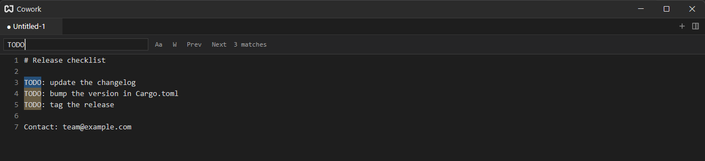
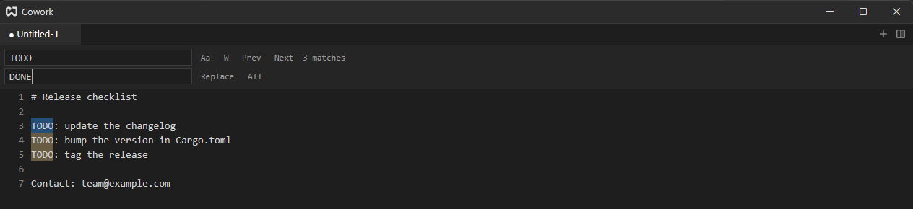
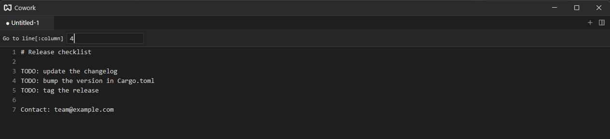

# Find, Replace & Go to Line

All three live in a bar at the top of the editor. The bar belongs to the tab you opened it in.

## Find {#find}

Press {#kb editor::Find}. If a single-line piece of text is selected it becomes the query; otherwise the bar opens empty with the caret in its input.

Matches are highlighted as you type, the first match at or after the cursor is selected, and the bar shows how many there are.

| Action         | Shortcut                                               |
| -------------- | ------------------------------------------------------ |
| Next match     | {#kb editor::FindNext} or `Enter` in the bar           |
| Previous match | {#kb editor::FindPrevious} or `Shift+Enter` in the bar |
| Close the bar  | {#kb editor::Cancel}                                   |

The `Aa` toggle makes the search case sensitive and `W` limits it to whole words. Without `Aa`, upper and lower case match for every language: `VIỆT` finds `việt`. Accents still count, so `viet` does not find `việt`, and text typed with the accent as a separate mark (`e` + `◌̂` + `◌̣`) is a different spelling from the single-character `ệ`.

`Next`/`Previous` wrap around at the ends of the document. Typing in the document while the bar is open refreshes the matches.

## Replace {#replace}

Press {#kb editor::Replace} to add a second input to the bar.

- **Replace** replaces the selected match and moves to the next one.
- **All** replaces every match in one step, so a single undo reverts it.

## Go to Line {#go-to-line}

Press {#kb editor::GoToLine}, type a line number, and press `Enter`. `12:5` goes to line 12, column 5. Numbers outside the document land on the nearest line.

The bar closes and the cursor moves to the line.
