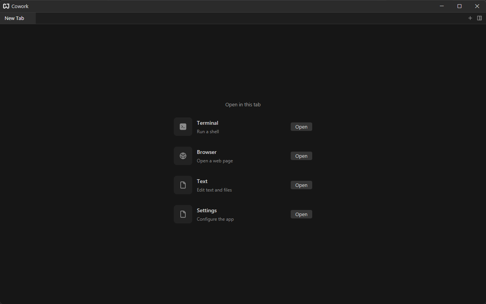
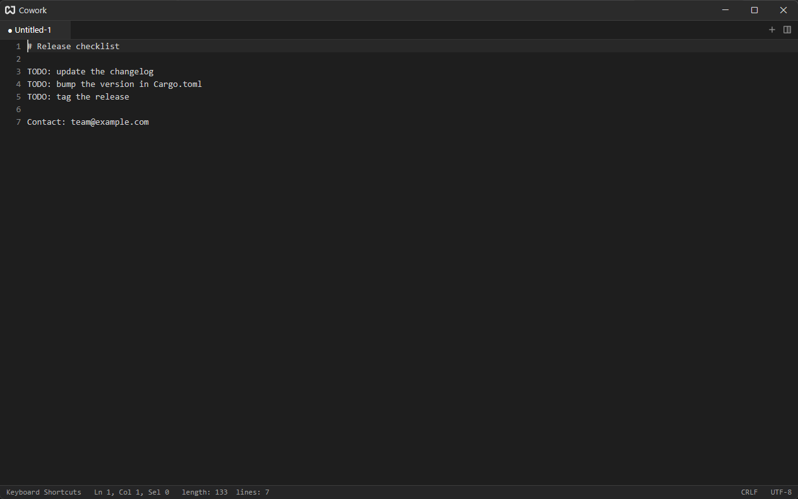

# Getting Started

Cowork is a desktop workspace built on [gpui](https://gpui.rs), the UI framework behind Zed. One window holds editors, terminals and browser pages as tabs in splittable panes. Whatever you were writing is still there the next time you open the app, saved or not.

## The Launcher {#launcher}

A new window, and every new tab, starts on the launcher. Pick what the tab should become:

| Choice       | What you get                                      | Read more                 |
| ------------ | ------------------------------------------------- | ------------------------- |
| **Terminal** | A shell running in the tab                        | [Terminal](./terminal.md) |
| **Browser**  | A Chromium page with its own address bar and tabs | [Browser](./browser.md)   |
| **Project**  | A folder as a workspace: explorer, search, git    | [Editor](./editor.md)     |
| **Text**     | An empty note you can type in, or open files into | [Editor](./editor.md)     |

Settings is not on the launcher: click the gear at the far left of the title bar, or press {#kb workspace::OpenSettings}. See [Settings](./settings.md).

The launcher replaces itself with your choice, so the tab keeps its place in the tab bar.

## Try It {#try-it}

1. Choose **Text** (or press {#kb workspace::NewFile} for a new note at any time).
2. Type something. The tab shows a dot, `● Untitled-1`: the note has changes that are not saved to a file.
3. Quit the app and start it again. The note is still there, with the cursor where you left it. See [Sessions & Quick Notes](./sessions.md).

## Essential Shortcuts {#essential-shortcuts}

| Action                      | Shortcut                      |
| --------------------------- | ----------------------------- |
| Command palette             | {#kb command_palette::Toggle} |
| New note                    | {#kb workspace::NewFile}      |
| Open a file                 | {#kb workspace::OpenFile}     |
| Save                        | {#kb editor::Save}            |
| Open settings               | {#kb workspace::OpenSettings} |
| Close the current tab       | {#kb pane::CloseActiveItem}   |
| Split the pane to the right | {#kb pane::SplitRight}        |

If you forget a shortcut, open the [command palette](./command-palette.md) and search for the action: its key binding is listed next to its name.

## What's Next {#whats-next}

- [Windows, Panes & Tabs](./windows-and-panes.md): arrange several things side by side.
- [Editor](./editor.md): the Notepad++-style editing commands.
- [Key Bindings](./key-bindings.md): change any editor shortcut from inside the app.
- [Settings](./settings.md): fonts, tab width, terminal and browser options.
