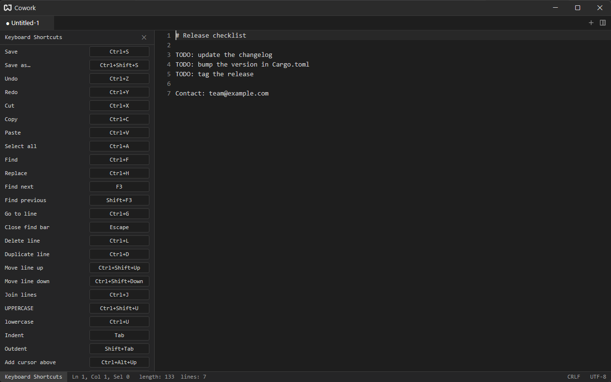
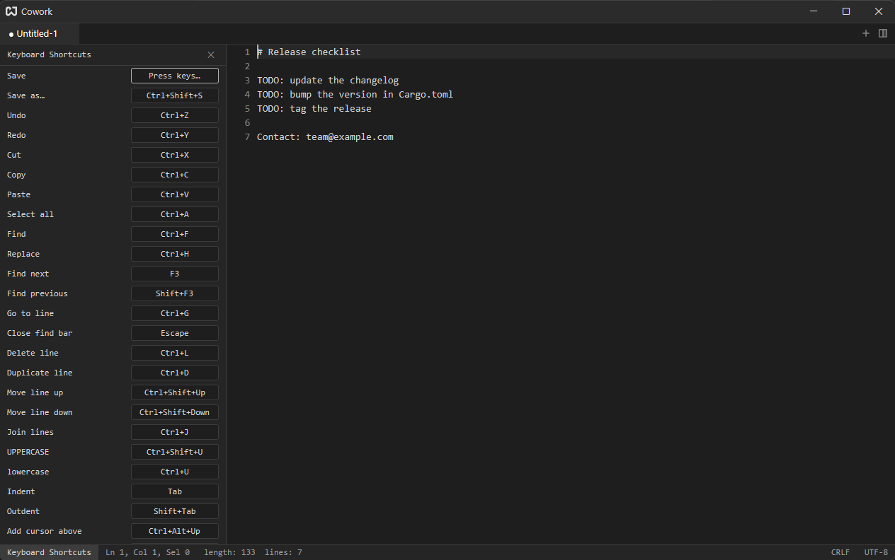

# Key Bindings

Every editor command has a default shortcut, and you can change any of them without editing a file.

## The Shortcuts Drawer {#shortcuts-drawer}

Click the **keyboard icon** at the right end of the editor's status bar. A drawer opens on the right of the editor and lists every shortcut the editor has.



Each row is a command and its keys. Click the **✕** in the drawer header, or the status-bar item again, to close it.

### Rebinding a Shortcut {#rebinding}

1. Click the keys of the command you want to change. The box reads **Press keys…**.
2. Press the new combination. It is applied at once and saved.
3. Press `Esc` instead to cancel.



While the box is waiting, nothing you press runs its old command, so any combination can be captured. Combinations of several strokes (like `Ctrl+K Ctrl+T`) cannot be recorded this way.

If you pick keys that another command already uses, that command becomes **unassigned** (it shows `—`). It is not deleted; give it new keys the same way.

### Resetting {#resetting}

A shortcut you changed is shown in color with a **↺** next to it. Click **↺** to put the default back. A shortcut that was taken from another command stays unassigned until you reset or rebind it too.

You can open the drawer straight on a command from the [command palette](./command-palette.md#change-keybinding). The same list, with the same rebinding, is on the Editor page of [Settings](./settings.md#editor).

## Where Changes Are Stored {#storage}

Changes are saved in `editor-keymap.txt` in the [config folder](./configuration-files.md), one line per change:

```text
editor::DeleteLine=ctrl-k
editor::DuplicateLineDown=
```

The format is `action=keys`. An empty value means the command has no shortcut. Delete a line, or the whole file, to go back to the defaults. The file is read when the app starts.

## Keystroke Syntax {#syntax}

Keys are written lowercase and joined with `-`: `ctrl-shift-s`, `alt-up`, `f3`, `tab`. The modifiers are `ctrl`, `alt`, `shift` and `cmd` (the Windows key / Command key). A binding of several strokes separates them with a space, as in `ctrl-k left`.

## Contexts {#contexts}

A shortcut applies in a **context**: where the focus is. Cowork uses these:

| Context                  | Where it applies                                                             |
| ------------------------ | ---------------------------------------------------------------------------- |
| `Workspace`              | Anywhere in the window (new note, open file, settings, moving between panes) |
| `Pane`                   | Inside a pane (close tab, split)                                             |
| `Editor`                 | Any text input: the editor, the find bar, the palette's search box           |
| `Editor && mode == full` | Only the document editor, not one-line inputs (up/down, tab, line commands)  |
| `Terminal`               | A terminal tab                                                               |
| `CommandPalette`         | While the command palette is open                                            |

The most specific context wins. That is why `Ctrl+W` closes a tab in an editor but goes to the shell in a terminal, and why the arrow keys move a list selection in the palette but the cursor in a document.

## What Can Be Rebound {#scope}

The drawer covers the editor's commands. These have fixed shortcuts for now: window and pane commands (new note, open, split, move between panes, quit), the [terminal](./terminal.md#keys) and the command palette's own keys.

Some commands also have a second, fixed shortcut that is not listed, for example `Ctrl+Shift+Z` for redo and `Shift+Delete` for cut. Rebinding a command leaves those alone.

See [Default Shortcuts](./reference/default-shortcuts.md) for the full list.
