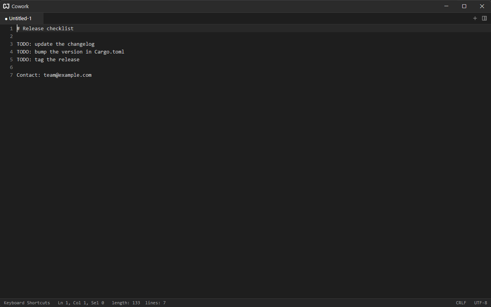

# Sessions & Quick Notes

Cowork behaves like Notepad++ here: open a note, type, quit, and open the app again. The text is still there, even if you never saved it to a file.

## What Is Remembered {#what}

- **Every pane and split**, with the size of each, and which pane and tab were active.
- **Untitled notes**: their whole text, name, cursor position and scroll position.
- **Files with unsaved edits**: your edited text, still marked as unsaved. The file on disk is not changed until you save.
- **Files without edits**: only the path. They are reopened from disk, so changes made to them elsewhere show up.
- **Terminals**: a terminal tab comes back with a new shell.
- **Browsers**: every page tab and its address.

The launcher tab and the Settings tab are not stored; a pane with no other tab gets a fresh launcher, and Settings opens again with the shortcut. Tabs you closed are forgotten: closing a tab is how you throw a note away.

If a remembered file has been deleted or moved, its tab is skipped.

## When It Is Saved {#when}

The session is written:

- every few seconds while the app runs, whenever something changed;
- when you close the window;
- when the app quits.

If the app is killed suddenly (a crash, or ending the process), you can lose the last few seconds of typing.

## Turning It Off {#off}

Turn off **Restore Session** on the General page of [Settings](./settings.md#general) to start empty every time. Browser pages have their own switch, **Restore Pages**, on the Browser page.

## Starting Fresh {#fresh}

Close the tabs you no longer want before you quit. To drop the whole session, quit the app and delete the `session` folder in the [config folder](./configuration-files.md).

## Where It Lives {#where}

In `session` inside the config folder: one `session.json` describing the layout and tabs, and a `.txt` file for each tab whose text exists only in the session. Do not edit these while the app is running.
