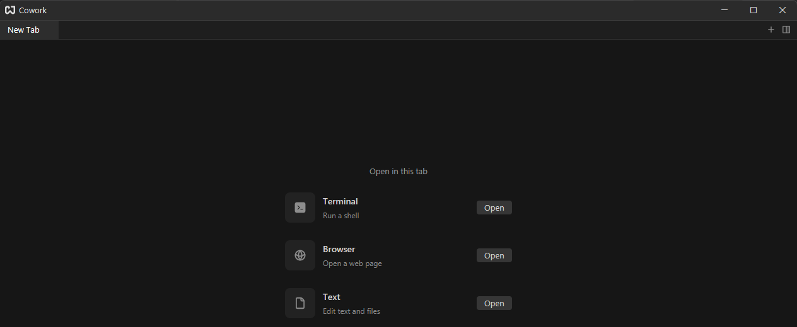
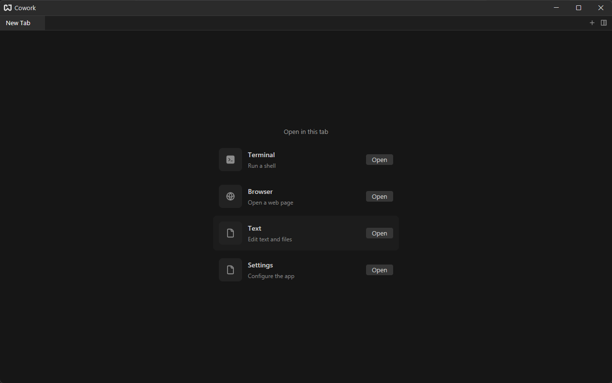
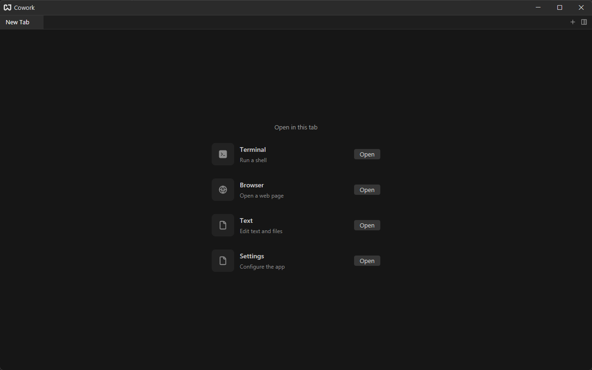

# Settings

Settings opens in a tab, like everything else in Cowork. Click the gear at the far left of the title bar, press {#kb workspace::OpenSettings}, or run {#action workspace::OpenSettings} from the [command palette](./command-palette.md).

The list on the left has one page per area: **General**, **Terminal**, **Editor**, **Browser** and **Agent**. Pick one to see its settings on the right. Changes apply and are saved to [`settings.json`](./configuration-files.md#settings) as soon as you make them. Where a text box says "Press Enter to apply", type the new value and press `Enter`.

## Searching {#searching}

Type in the search box above the list to find a setting by its name or description. The list shows only the pages with a match, and the right side shows just the matching settings.

Clear the box to see the pages again.

## General {#general}

| Setting             | Default | What it does                                                                 |
| ------------------- | ------- | ---------------------------------------------------------------------------- |
| **Restore Session** | on      | Reopen the previous session's tabs on launch. See [Sessions](./sessions.md). |
| **Config Folder**   |         | Shows where `settings.json` is stored.                                       |

## Terminal {#terminal}

| Setting                    | What it does                                                                |
| -------------------------- | --------------------------------------------------------------------------- |
| **Font Family**            | Font for terminal text (Enter to apply)                                     |
| **Font Size**              | Terminal text size                                                          |
| **Line Height**            | Spacing between lines: Comfortable, Standard or Custom                      |
| **Custom Line Height**     | Line height multiplier; changing it switches Line Height to Custom          |
| **Cursor Shape**           | Block, Underline, Bar or Hollow                                             |
| **Cursor Blinking**        | Whether the cursor blinks                                                   |
| **Alternate Scroll**       | The mouse wheel sends arrow keys in full-screen programs                    |
| **Option as Meta**         | Treat the Option/Alt key as Meta                                            |
| **Copy on Select**         | Copy selected text to the clipboard automatically                           |
| **Keep Selection on Copy** | Keep the text selected after copying it                                     |
| **Max Scroll History**     | Lines kept in the scrollback; empty means unbounded                         |
| **Scroll Multiplier**      | Scroll speed                                                                |
| **Minimum Contrast**       | Minimum contrast between text and its background (0 turns it off)           |
| **Shell**                  | Which shell new terminals start (the system default, or a program you name) |
| **Shell Program**          | Path or name of the shell; empty uses the system shell                      |
| **Shell Arguments**        | Space-separated arguments for the shell program                             |
| **Environment Variables**  | Extra `KEY=VALUE` variables for new terminals                               |

Terminal settings that say "Applies to new terminals" do not change terminals that are already open; open a new terminal tab to see them.

## Editor {#editor}

| Setting       | Default | What it does            |
| ------------- | ------- | ----------------------- |
| **Font Size** | 14      | Text size in the editor |
| **Tab Size**  | 4       | Spaces a tab stop spans |

Below them, **Keyboard Shortcuts** lists every editor shortcut, the same list as the [shortcuts drawer](./key-bindings.md#shortcuts-drawer). Click the keys of a command and press the new combination; the box reads **Press keys…** while it waits.

## Browser {#browser}

| Setting           | Default       | What it does                                                               |
| ----------------- | ------------- | -------------------------------------------------------------------------- |
| **Home URL**      | `about:blank` | The page opened by the `+` in the browser's own tab strip (Enter to apply) |
| **Restore Pages** | on            | Reopen browser pages from the previous session                             |

## Agent {#agent}

The Agent page stores the launch configuration for an agent that speaks the [Agent Client Protocol](https://agentclientprotocol.com): its program path, arguments, environment variables, protocol version and MCP servers. Cowork has no agent tab yet, so these values are saved but have no effect today; the page says so at the top.
