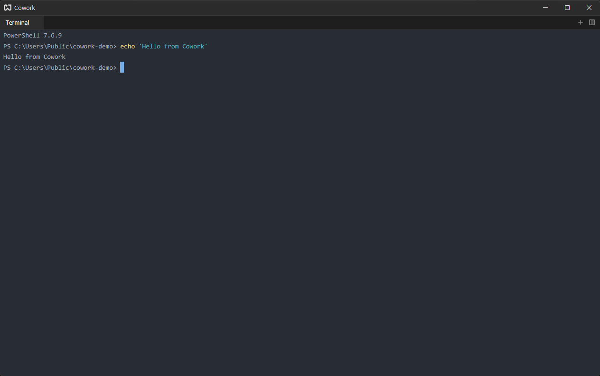

# Terminal

Choose **Terminal** on the [launcher](./getting-started.md#launcher) to run a shell in a tab. The emulator is a port of Zed's terminal (alacritty's terminal engine underneath), so it handles full-screen programs, colors and mouse reporting.

## Opening Terminals {#opening}

Click the `+` in the tab bar and choose **Terminal**, or turn an existing launcher tab into one. Each terminal tab is its own shell. Splitting a terminal tab starts a new shell in the new pane; it does not copy the running session.

The shell starts in the background, so the tab appears immediately. If the shell cannot be started, the error is printed in the tab.

## The Tab Title {#title}

The tab is named after the title the shell sets (with `title` in `cmd`, or the usual escape sequence in other shells). When the shell exits, the tab closes.

## Keys {#keys}

Most keys go straight to the shell. These are handled by the terminal itself:

| Action                  | Shortcut                                                          |
| ----------------------- | ----------------------------------------------------------------- |
| Copy                    | `Ctrl+Shift+C`, `Ctrl+Insert`, or `Ctrl+C` while text is selected |
| Paste                   | `Ctrl+V`, `Ctrl+Shift+V`, `Shift+Insert`                          |
| Select all              | `Ctrl+Shift+A`                                                    |
| Clear                   | `Ctrl+Shift+L`                                                    |
| Scroll a line up / down | `Shift+Up` / `Shift+Down`                                         |
| Scroll a page up / down | `Shift+PageUp` / `Shift+PageDown`                                 |
| Scroll to top / bottom  | `Shift+Home` / `Shift+End`                                        |
| Vi mode                 | `Ctrl+Shift+Space`                                                |
| Close the tab           | `Ctrl+Shift+W`                                                    |
| Split to the right      | `Ctrl+Shift+5`                                                    |

`Ctrl+C` without a selection is the shell's interrupt.

### Shortcuts the Shell Keeps {#shell-keys}

Many shells and programs use `Ctrl+W`, `Ctrl+N`, `Ctrl+O`, `Ctrl+R`, `Ctrl+Q` and `Ctrl+B`, so inside a terminal those go to the program, not to Cowork. That means:

- {#kb pane::CloseActiveItem} deletes a word in the shell. Close a terminal tab with `Ctrl+Shift+W`.
- {#kb workspace::NewFile} and {#kb workspace::OpenFile} do not work while a terminal has focus. Click an editor, or use the [command palette](./command-palette.md).
- {#kb app::Quit} goes to the shell; quit from an editor or use the window's close button.

The [pane shortcuts](./windows-and-panes.md#moving) that start with `Ctrl+K` still work.

## Settings {#settings}

Font, cursor, scrolling, copy behavior and the shell are set on the Terminal page of [Settings](./settings.md#terminal). Changes apply to terminals opened afterwards.

## Scrollback {#scrollback}

The terminal keeps a long history of output. Scroll with the mouse wheel or the `Shift` keys above. Programs that use the alternate screen (editors, pagers) get the wheel as arrow keys.

## Sessions {#sessions}

A terminal tab is remembered by the [session](./sessions.md): after a restart the tab is back, with a new shell. The old shell's output and running processes are not kept.
