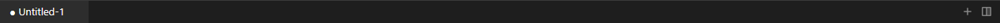
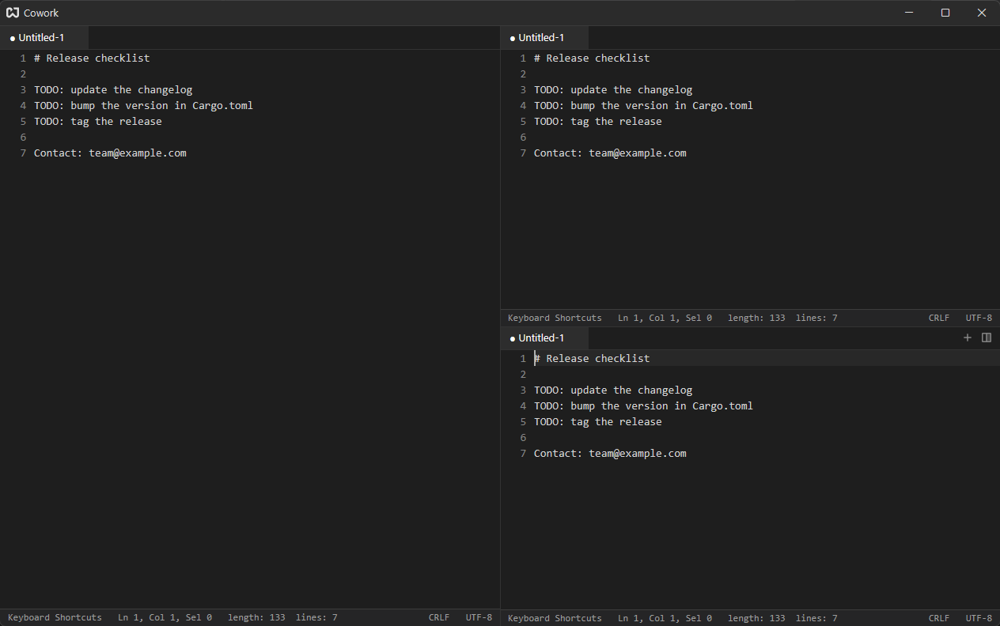

# Windows, Panes & Tabs

Cowork has one window. The window is a grid of **panes**; each pane has its own **tab bar**, and each tab is an editor, a terminal, a browser or a [launcher](./getting-started.md#launcher).

## Tabs {#tabs}

| Action                   | How                           |
| ------------------------ | ----------------------------- |
| New tab (shows launcher) | The `+` button in the tab bar |
| New empty note           | {#kb workspace::NewFile}      |
| Open files               | {#kb workspace::OpenFile}     |
| Close the active tab     | {#kb pane::CloseActiveItem}   |
| Activate a tab           | Click it                      |

A dot before a tab's name means the note has unsaved changes. A [terminal](./terminal.md) keeps {#kb pane::CloseActiveItem} for the shell; close terminal tabs with `Ctrl+Shift+W`.

Closing the last tab of a pane removes the pane. The last pane in the window is never removed: it falls back to an empty tab bar.

## Splitting {#splitting}

The split button at the right end of the tab bar opens a menu: **Split Right**, **Split Left**, **Split Up**, **Split Down**. The same splits are on the keyboard:

| Split | Shortcut               |
| ----- | ---------------------- |
| Right | {#kb pane::SplitRight} |
| Up    | {#kb pane::SplitUp}    |
| Down  | {#kb pane::SplitDown}  |
| Left  | {#kb pane::SplitLeft}  |

What the new pane holds depends on the tab you split:

- **Editor**: an independent copy of the text. The copy opens the same file but has its own edits and cursor, so changes in one are not mirrored into the other.
- **Terminal**: a fresh shell. A running session cannot be duplicated.
- **Browser**: a new browser with one blank tab.

## Moving Between Panes {#moving}

| Action                          | Shortcut                           |
| ------------------------------- | ---------------------------------- |
| Focus the pane on the left      | {#kb workspace::ActivatePaneLeft}  |
| Focus the pane on the right     | {#kb workspace::ActivatePaneRight} |
| Focus the pane above            | {#kb workspace::ActivatePaneUp}    |
| Focus the pane below            | {#kb workspace::ActivatePaneDown}  |
| Swap with the pane on the left  | {#kb workspace::SwapPaneLeft}      |
| Swap with the pane on the right | {#kb workspace::SwapPaneRight}     |
| Swap with the pane above        | {#kb workspace::SwapPaneUp}        |
| Swap with the pane below        | {#kb workspace::SwapPaneDown}      |

These are two-key chords: press the first combination, release, then press the second.

Drag the thin line between two panes to resize them.

## Window Controls {#window-controls}

Cowork draws its own title bar. On Windows it has minimize, maximize and close buttons; on macOS the system's traffic lights are used. Drag the title bar to move the window. {#kb app::Quit} quits the app.
